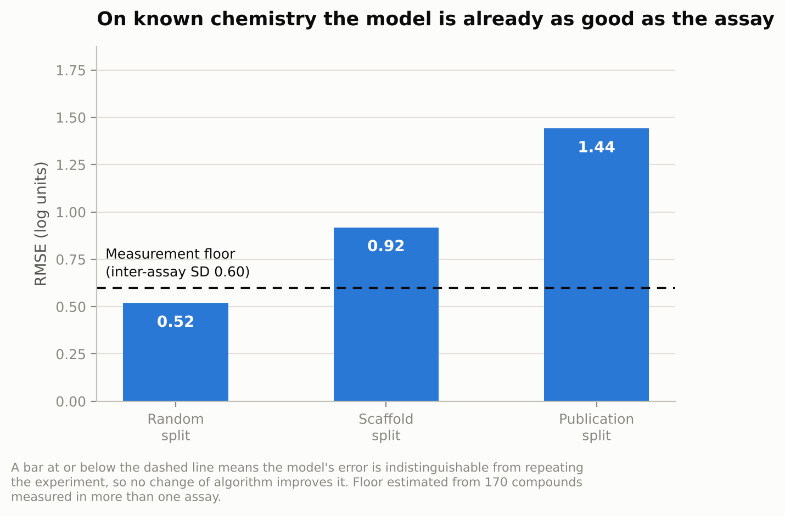
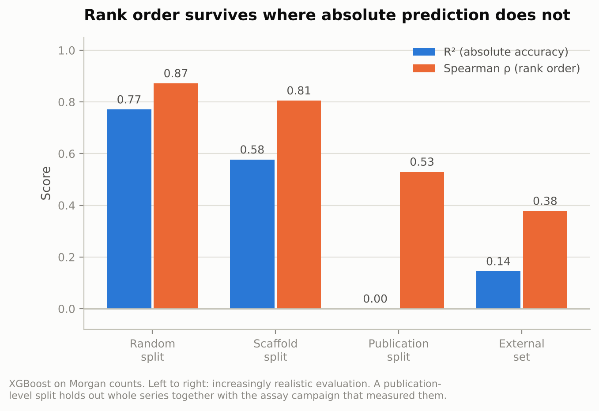
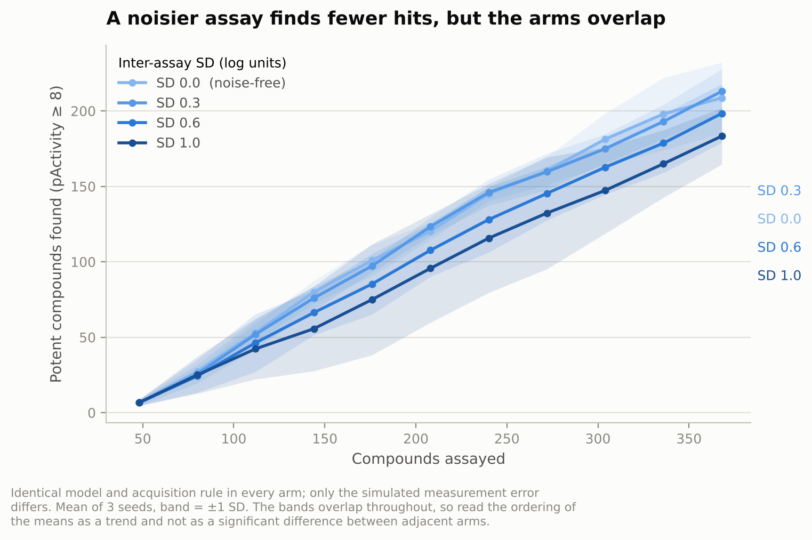
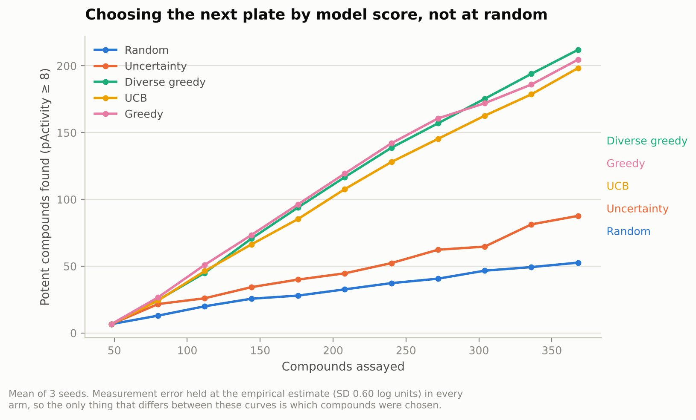

# A2A receptor QSAR, with the assay in the loop

[](https://github.com/wang3ji/QSAR-RDKit-Drug-Discovery/actions/workflows/ci.yml)


Potency models for the human adenosine A2A receptor (CHEMBL251), built to
answer a question most QSAR studies skip: **the activity column is not the
truth, it is a measurement with a standard deviation — so what does the
quality of that measurement cost an AI-driven discovery campaign?**

Most QSAR repositories train a model, report R² on a random split, and stop.
This one estimates the error of the experiment that produced its own labels,
shows that the model has already reached that error floor, and then simulates
an iterative screening campaign in which the assay feeding the model is
imperfect — so the cost of a weaker assay is measured in compounds, not
asserted.

## What it found

**1. The model is already as accurate as the experiment.** Inter-assay
reproducibility, estimated from 170 compounds measured in more than one assay,
is **0.60 log units**. On a random split the model's RMSE is **0.52**. The
remaining error is indistinguishable from repeating the measurement, so no
change of algorithm improves it — only better experiments would.

**2. Rank order survives where absolute prediction collapses.** Held out by
publication, so that a whole series and its assay campaign are unseen, R²
falls to **0.00** while Spearman ρ holds at **0.53**. The model cannot tell you
a compound's potency. It can still tell you which compounds to put on the next
plate, at **4.9× enrichment** over random picking on a 3,995-compound external
set.

**3. Assay quality, not model choice, sets the ceiling on hit calling.** At the
measured noise level, a nominal hit list at pActivity ≥ 8 is **27% false
positives**, and **20% of genuinely potent compounds never get called at all**.
Halving the noise to 0.30 cuts false positives from 168 to 73 per 3,995
compounds screened.

**4. The uncertainty is honest about chemistry it knows, and overconfident
about chemistry it does not.** Conformal intervals at a nominal 80% level
cover 86% on a random split, 73% on a scaffold split, and **55% held out by
publication** — least trustworthy in exactly the situation where a project team
would most want to rely on them. Reported rather than omitted, because a
silently overconfident interval is worse than no interval.

**5. Model-guided plate selection found 4.0× more potent compounds than
random picking**, for exactly the same number of wells: 212 of the deck's 556
actives after assaying 368 of 3,995 compounds (9.2% of the deck), against 53
for random selection. Penalising scaffolds already on a plate — the rule a
project team actually applies when filling one — found just as many actives
while covering **248 scaffolds instead of 160**, so series diversity came free.

| Selection rule | Actives found | Recall of deck actives | Scaffolds assayed |
|---|---|---|---|
| Diverse greedy | **212** ± 3 | 38.1% | **248** |
| Greedy | 205 ± 19 | 36.8% | 160 |
| UCB (exploit + explore) | 198 ± 19 | 35.7% | 171 |
| Uncertainty only | 88 ± 15 | 15.8% | 226 |
| Random | 53 ± 7 | 9.5% | 267 |

After 11 rounds of 32 compounds, mean ± SD over 3 seeds, measurement error
held at the empirical 0.60 log units in every arm. Pure uncertainty sampling
is the instructive failure: it learns the structure-activity landscape
efficiently and finds few hits, which is the right reminder that "informative"
and "valuable" are different objectives.


## Figures









## Results in full

XGBoost on count-based Morgan fingerprints, 983 modelling compounds. Splits
are ordered from optimistic to realistic; the gap between them is the result.

| Split | What it asks | R² | Spearman ρ | RMSE | RMSE / assay SD | 80% interval coverage |
|---|---|---|---|---|---|---|
| Random | Interpolation within known chemistry | 0.77 | 0.87 | 0.52 | 0.86 | 0.86 |
| Scaffold | A new scaffold | 0.58 | 0.81 | 0.92 | 1.53 | 0.74 |
| Publication | A new series *and* a new assay campaign | 0.00 | 0.53 | 1.44 | 2.40 | 0.47 |
| External set (3,995 compounds) | An independent curation of the same target | 0.15 | 0.38 | — | — | — |

A random forest is within noise of XGBoost everywhere and has better-behaved
uncertainty: its per-tree spread tracks real error monotonically on random
(2.7×) and scaffold (3.8×) splits, which is why it is the default model for
the campaign simulation. Adding physicochemical descriptors to the
fingerprints changes nothing beyond the third decimal place — worth knowing,
and worth reporting as a negative result rather than quietly dropping.

Full numbers: [`reports/benchmark.csv`](reports/benchmark.csv),
[`reports/assay_noise.json`](reports/assay_noise.json),
[`reports/curation.json`](reports/curation.json).

## How the assay model works

The point of the simulation is that only one thing differs between arms, so any
difference in outcome is attributable to that one thing.

A held-out set of 3,995 A2A ligands is treated as an unscreened deck. Their
measured potencies are the ground truth and are hidden. Each round the model
is retrained on everything assayed so far, scores the remaining deck, and a
batch of 32 compounds — roughly a dose-response plate — is selected and
"assayed" through a simulator that adds inter-assay noise and censors anything
outside the dynamic range. The model therefore learns from the same imperfect
numbers a real campaign would hand it, while scoring is done against the truth.

Three things that happen on a real plate are modelled explicitly:

- **Inter-assay variability** — a Gaussian term on the log scale, whose width
  is *estimated from replicate measurements in the data*, not assumed.
- **Dynamic range** — potency cannot be read beyond the top and bottom of the
  curve, so values outside it are censored to the limit and flagged, the way a
  real report states `> 10 µM`.
- **Plate quality** — `sd_for_zprime()` scales the variability term by assay
  robustness, which is how a weak assay actually degrades a campaign.

The estimate deserves a note. The *median* within-compound standard deviation
is 0.11 log units, but the *pooled* value — the square root of the mean
within-compound variance, which is the right summary for a Gaussian noise term
because variances add while standard deviations do not — is 0.60. Both are
reported. The pooled figure lands squarely in the 0.5–0.7 range found for
public pIC50 data by Kramer et al. (2012) and Kalliokoski et al. (2013),
which is a reassuring independent check on a number derived here from 170
compounds.

## Reproducing

```bash
git clone https://github.com/wang3ji/QSAR-RDKit-Drug-Discovery.git
cd QSAR-RDKit-Drug-Discovery
pip install -e ".[dev,plots]"

a2a-qsar curate         # standardise structures, aggregate replicates    (~1 min)
a2a-qsar assay-noise    # estimate inter-assay error and its cost         (~1 min)
a2a-qsar benchmark      # models x representations x splits                (~2 min)
a2a-qsar campaign       # the screening-campaign simulation               (~45 min)
a2a-qsar figures        # render the figures above
```

Every number in this README comes from one of those commands. All randomness
is seeded, the data snapshots are committed, and CI regenerates the headline
numbers on every change, so a result here cannot drift from the code that
produced it.

For a quicker look, `a2a-qsar campaign --experiment assay-quality --rounds 4
--replicates 1` finishes in a couple of minutes.

## What is in here

```
src/a2a_qsar/
  data.py       structure standardisation, replicate aggregation, curation report
  features.py   Morgan counts, physicochemical descriptors, scaffolds, Tanimoto
  splits.py     random / scaffold / publication-level splits
  models.py     random forest, bagged XGBoost, split-conformal intervals
  assay.py      empirical noise estimation, measurement simulator, hit confirmation
  active.py     iterative campaign simulation and five acquisition rules
  evaluate.py   metrics chosen for ranking and triage, not just R²
  plots.py      the figures above
  cli.py        one command per experiment
tests/          63 tests, including the behaviour each scientific claim rests on
data/raw/       committed snapshots + PROVENANCE.md
docs/           model card: intended use, out-of-scope uses, known biases
notebooks/      the original exploratory notebooks this grew out of
reports/        generated results and figures
```

Some decisions worth calling out, because they are the difference between a
notebook and something a team could run:

- **Count fingerprints, not bits.** How many times a substructure occurs
  carries SAR signal that a binary vector discards.
- **Publication-level splits.** Compounds reported together were usually made
  together and screened in one campaign. Holding out whole publications breaks
  the shared experimental conditions as well as the shared chemistry, which a
  scaffold split does not.
- **Conformal intervals over raw ensemble spread.** Split conformal prediction
  gives a finite-sample coverage guarantee under exchangeability; scaling the
  residuals by the model's own spread keeps the interval adaptive. Where
  exchangeability is broken on purpose, the measured coverage is reported as a
  result.
- **Enrichment and rank correlation as first-class metrics.** The model is used
  to choose plates, so it is scored the way it is used.
- **Tests that encode the science.** That zero-noise campaigns make no false
  calls, that pooled SD exceeds median SD, that a scaffold split leaks no
  scaffold, that greedy selection beats random — each is a test, so a
  refactor cannot quietly break a claim in this README.

## Limitations

- Public potency data is reported because it was worth reporting, so weak
  compounds are under-represented and the training median (pActivity 7.5) is
  shifted towards potency.
- 983 compounds carry far fewer than 983 independent chemotypes, which is why
  the random-split numbers are the least meaningful ones here.
- IC50 and EC50 values from 55 assays are pooled on the pActivity scale. This
  is standard for regression-ready extracts and is part of why the measured
  inter-assay spread is as wide as it is.
- Inexact relations (`>`, `<`) are excluded, which removes genuinely inactive
  compounds and biases the retained set further towards actives.
- The simulation is retrospective. It shows what a campaign *would have* done
  on compounds whose potency is already known; it does not prospectively
  nominate anything. No compound here has been synthesised or tested on the
  basis of these models.
- The noise model is Gaussian and homoscedastic on the log scale. Real assay
  error grows near the limits of the dynamic range, which would make the
  conclusions stronger, not weaker.

See [`docs/model_card.md`](docs/model_card.md) for intended use, out-of-scope
uses and known biases in full.

## Why this project

I have spent thirteen years designing and validating the quantitative assays
that models like these learn from — HTRF, BRET, MSD and luminescence readouts,
CRISPR and CRISPRa/i perturbation, RNA-seq study design — most recently
running small-molecule screening campaigns for adenosine receptor allosteric
modulators. Working on both sides of that handoff, the thing I keep seeing is
that the data-generating experiment is treated as a fixed input to the model
rather than as something that can be designed alongside it.

This repository is that argument made quantitative, on the target I know best:
the assay and the model are one loop, and the measurement is often the binding
constraint.

## Data and licence

Both data snapshots are public, independently curated ChEMBL extracts for
CHEMBL251 / UniProt P29274, committed with full provenance in
[`data/raw/PROVENANCE.md`](data/raw/PROVENANCE.md). Code is GPL-3.0; see
[LICENSE](LICENSE).

## References

- Kramer C. *et al.* The experimental uncertainty of heterogeneous public Ki
  data. *J Med Chem* 55:5165–5173 (2012).
- Kalliokoski T. *et al.* Comparability of mixed IC50 data — a statistical
  analysis. *PLoS ONE* 8:e61007 (2013).
- Bemis G.W., Murcko M.A. The properties of known drugs. 1. Molecular
  frameworks. *J Med Chem* 39:2887–2893 (1996).
- Lei J., Tibshirani R.J. Distribution-free predictive inference for
  regression. *J Am Stat Assoc* 113:1094–1111 (2018).
- Zhang J.H., Chung T.D., Oldenburg K.R. A simple statistical parameter for use
  in evaluation of high throughput screening assays. *J Biomol Screen*
  4:67–73 (1999).

---

**Jingjing Wang, Ph.D.** · [github.com/wang3ji](https://github.com/wang3ji) ·
[LinkedIn](https://linkedin.com/in/jingjing-wang-8b54b0134)
